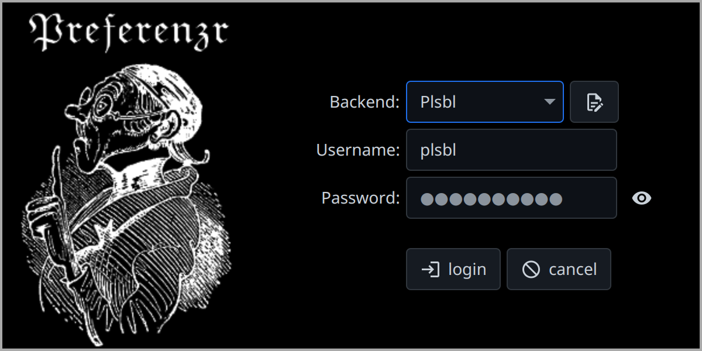
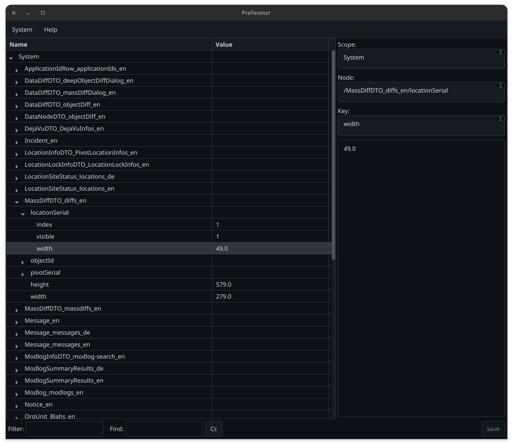

# Preferenzr — User Manual

Preferenzr is a tool to browse and edit the preferences of a Tentackle application.

Tentackle applications do not store their preferences in the local preferences store of the
operating system, but in their own database. Window sizes, column widths, filter settings, user
options and everything else an application remembers therefore live in the same database as the
application data — for the system as a whole and for every single user. Preferenzr connects to such
a database and lets you look at those settings and change them.

Typical tasks:

* find out what an application has stored for a user,
* repair a setting that prevents a user from working (a window moved off-screen, a broken filter),
* copy a working configuration from one user to another,
* keep a backup of a preferences subtree before changing it.

> **Please note:** Preferenzr edits the live settings of a running application. Changes are picked up
> by the running applications automatically. Nothing is written until you press **save**, so you can
> always back out before that point.

---

## Contents

1. [Starting Preferenzr](#starting-preferenzr)
2. [The main window](#the-main-window)
3. [Browsing the preferences](#browsing-the-preferences)
4. [Changing a value](#changing-a-value)
5. [Adding nodes and keys](#adding-nodes-and-keys)
6. [Removing nodes and keys](#removing-nodes-and-keys)
7. [Saving and discarding](#saving-and-discarding)
8. [Filtering the tree](#filtering-the-tree)
9. [Searching](#searching)
10. [Dumping preferences to a file](#dumping-preferences-to-a-file)
11. [Loading a dump](#loading-a-dump)
12. [Settings of Preferenzr itself](#settings-of-preferenzr-itself)
13. [Help and version information](#help-and-version-information)
14. [Keyboard shortcuts](#keyboard-shortcuts)

---

## Starting Preferenzr

Start Preferenzr with `preferenzr.sh` (Linux, macOS) or `preferenzr.cmd` (Windows) from the `bin`
directory of the installation. The login window appears:

**Backend**
: The database to work on. The drop-down lists the configured backends. The button next to it opens
  the backend administration, where a connection can be created or changed (name, URL, driver, user
  and password) and one of them can be marked as the default.

**Username** and **Password**
: Unlike in a normal Tentackle application, these are the credentials of the *database connection*,
  not of an application user. Preferenzr has no user administration of its own. When the selected
  backend already carries a user and password, both fields are filled in for you and you only have
  to confirm.

Press **login** to connect, **cancel** to quit. If the installation is configured for automatic
login, the login fields are not shown at all and Preferenzr connects right away.

The user interface follows the language of your desktop; English and German are available.

> Preferenzr only needs access to the tables holding the preferences, so it can — and should — be
> used with a database account with restricted privileges. Its own settings are never written into
> the database you are editing; they are kept locally on your machine.

---

## The main window

The window is divided into four areas:

* **The menu bar** with the menus **System** and **Help**.
* **The preferences tree** on the left, with the columns **Name** and **Value**. It shows all
  preference trees of the database, one below the other.
* **The editor** on the right. It shows where the selected entry lives — **Scope**, **Node** and
  **Key** — and, for a key, its value in the large text area below.
* **The bottom bar** with the **Filter** and **Find** fields, the **Cc** button, the number of
  pending changes and the **save** button.

---

## Browsing the preferences

The tree contains one top-level entry per *scope*:

* **System** — the settings that apply to the application as a whole, i.e. to all users.
* One entry per **user name** — the personal settings of that user, in alphabetical order.

Below a scope, the preferences are organized like a directory tree. A branch is a *node*; the leaves
are *keys*, and only keys carry a value in the **Value** column. Click the small triangle to open a
node.

Selecting an entry shows it in the editor on the right, so you can always see the full scope and
path of what you are looking at, even deep inside the tree — for example the key `width` of the
node `/MassDiffDTO_diffs_en/locationSerial` in the **System** scope, as shown above.

Entries whose text is too long for the tree column can be read comfortably in the editor: the
**Scope**, **Node** and **Key** fields can be expanded when the text does not fit.

---

## Changing a value

1. Select the key in the tree.
2. Edit the text in the large text area on the right.
3. Leave the field, for example by selecting another entry.

The change is now recorded, but only inside Preferenzr — nothing has been written to the database
yet. You can see this in two places:

* The row of the key is highlighted in the tree (see the [colour legend](#colour-legend) below).
* The number of pending changes appears at the bottom right ("1 modification", "5 modifications"),
  and the **save** button becomes available.

Setting a value back to its original text removes the change again, and the highlight disappears.

Values are plain text. How the owning application interprets the text — as a number, a flag, a
colour or a list — depends on that application. Preferenzr does not check the format, so take care
to write exactly what the application expects.

---

## Adding nodes and keys

Right-click an entry in the tree to open its context menu. Besides the standard table functions it
offers:

**new node**
: Creates a sub-node below the selected node. Enter the name of the new node — it must not be empty
  and must not contain a slash (`/`), because the slash separates the levels of the path. The name
  of the parent node is shown in the dialog for orientation.

**new key**
: Creates a key inside the selected node. Enter the key name and, optionally, its value right away.

Both entries are only available when a node is selected — keys cannot contain anything, and nodes
marked for deletion cannot be extended.

New nodes and keys appear immediately in the tree, highlighted as new. Creating a node or key that
already exists does not duplicate it: the existing entry is used, and if it was marked for deletion,
that deletion is taken back.

---

## Removing nodes and keys

Select the entry, then choose **remove** from the context menu.

* Removing a **key** marks that key.
* Removing a **node** marks the node *and everything below it* — all sub-nodes and all their keys.
  Preferenzr asks for confirmation and names the node it is about to remove.

Marked entries stay visible and are highlighted, so you can see exactly what will disappear when you
save. Nothing is deleted in the database until then.

To take a deletion back, either create a node or key of the same name again — this revives the
existing entry — or discard all changes (see below).

---

## Saving and discarding

**save** (bottom right) writes all pending changes to the database in a single step: nothing is
written at all, or everything is. Afterwards the tree is reloaded from the database, so what you see
is always the stored state. The button is greyed out while there is nothing to save.

Running Tentackle applications notice the change and refresh their preferences by themselves — you
do not have to restart them. Bear in mind, though, that an application which has already read a
setting may only use the new value the next time it needs it.

**System ▸ discard changes** throws away *all* pending changes and reloads everything from the
database. Use it whenever you want to get back to a clean state; it is also the quickest way to undo
a removal you did not intend.

Closing the window (**System ▸ Exit** or the window's close button) asks for confirmation. If there
are unsaved changes, the question says so explicitly — leaving the program never saves anything
implicitly.

### Colour legend

| Highlight | Meaning |
|---|---|
| green | newly created, does not exist in the database yet |
| blue  | value changed |
| red   | marked for deletion |

---

## Filtering the tree

The **Filter** field at the bottom reduces the tree to the interesting parts. Type a text and press
**Enter** (or `F2`). Preferenzr then shows only those entries whose name or value contains the text —
including all their parent nodes, so you can see where a match sits, and the remaining tree is
expanded automatically.

* Press `F2` to apply the filter, `Shift-F2` to clear it and show everything again.
* Start the text with `!` or `-` to invert the filter, e.g. `-width` shows everything that does
  *not* contain "width".
* The **Cc** button toggles case sensitivity. While it is not pressed, upper and lower case are
  treated alike.

The filter only changes what you see. Entries hidden by a filter keep their pending changes, and
**save** always writes all of them.

---

## Searching

The **Find** field jumps from match to match instead of hiding anything. Type a text and press
**Enter**, `F3` or `Shift-F3`.

* `F3` — find the next match, `Shift-F3` — find the previous one.
* The search covers names *and* values and starts at the currently selected entry.
* When the end of the tree is reached, the search continues at the beginning.
* The **Cc** button applies here as well.

Every match is selected, scrolled into view — opening the nodes above it if necessary — and shown in
the editor, so you can change it immediately and then jump on with `F3`.

Filter and search work together: filter first to narrow things down, then search within the result.

---

## Dumping preferences to a file

A dump is a copy of a node with everything below it, written to a file. Use it as a backup before
larger changes, or to transfer a configuration to another user or another database.

1. Select the node to dump. (If a key is selected, the node containing it is dumped.)
2. Choose **System ▸ Dump...**.
3. Confirm or change the proposed file name.

Preferenzr proposes a name built from scope and path, for example
`system_MassDiffDTO_diffs_en_locationSerial.xml`, and offers the directory you used last time.

Entries currently marked for deletion are not written to the dump. Everything else is written as it
is currently shown, including changes that have not been saved yet.

Dumps use the standard XML format for preferences, so they can also be read by other Java
applications, and files exported by such an application can be loaded into Preferenzr.

---

## Loading a dump

1. Choose **System ▸ Load...** and pick the file.
2. The load dialog appears and shows the file name and the node the dump was taken from.
3. Choose the target and the mode, then press **load**.

**Load into**
: Either the **system preferences** or a **user**. The list offers all users that already have
  preferences; you can also type a name that does not exist yet — the tree for that user is then
  created. Preferenzr preselects the scope the dump came from.

**Mode**
: **merge** — the dumped keys are added, existing keys of the same name are overwritten, everything
  else in the target is left untouched.
: **replace** — the dumped node is deleted in the target first, so that afterwards it contains
  exactly what the dump contains.

The dump is applied to the tree in Preferenzr only. You can review the result — everything appears
highlighted as new, changed or removed — and then either **save** it or use **discard changes** to
throw it away. This makes it safe to load a dump into the wrong user by accident.

---

## Settings of Preferenzr itself

**System ▸ Preferences** opens the settings of Preferenzr. They are stored locally on your computer,
never in the database you are editing.

| Setting | Meaning |
|---|---|
| help URL | the address opened by **Help ▸ Online Manual** |
| visible rows in value text area | the height of the value editor on the right |

Press **save** in the dialog to keep the settings, **cancel** to discard them.

---

## Help and version information

**Help ▸ Online Manual** opens the configured help address in your web browser. If no address has
been configured yet, Preferenzr tells you so — enter it in the settings as described above.

**Help ▸ About** briefly shows the version of Preferenzr, the version of the underlying Tentackle
framework and the Java version in use. Please quote these when reporting a problem.

---

## Keyboard shortcuts

| Key | Action |
|---|---|
| `F2` | apply the filter |
| `Shift-F2` | clear the filter, show all entries |
| `F3` | find next |
| `Shift-F3` | find previous |
| `Enter` in **Filter** | apply the filter |
| `Enter` in **Find** | find from the current entry |
